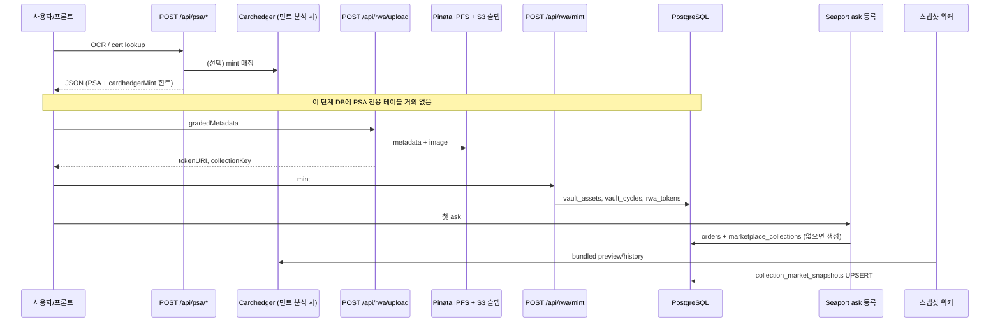

# Tokenable — DB·마켓·가격 데이터 구조 (학습용 메모)

> **목적:** 로컬 DB(TablePlus)로 테이블을 보면서, “collection / card / 가격이 어디에 저장되나?”를 한 번에 잡기 위한 **루트 요약 문서**.  
> **SSOT:** 구현·DDL은 `backend/src/**/entities/*.ts`, `backend/sql/schema/*.sql`, `docs/architecture/` 를 따른다. 이 파일은 2026-03 시점 스냅샷이며, 제거된 기능(어드민 Partner bulk mint 등)은 반영했다.

---

## 1. 한 줄로 보는 세 가지 축

| 축 | 질문 | 핵심 테이블 |
|----|------|-------------|
| **물리 카드 + NFT** | 이 PSA cert / 이 tokenId는 누구 것? | `vault_assets`, `vault_cycles`, `rwa_tokens` |
| **마켓 “버킷”(컬렉션)** | 같은 parallel·같은 카드 라인을 묶는 키는? | `marketplace_collections` (`collection_key`) |
| **외부 시세(Cardhedger)** | 리스트/상세에 보이는 FMV·차트는? | `collection_market_snapshots` (버킷당 1행) |

**중요:** Postgres에 `cards` 테이블은 **없다**. “카드”는 (1) IPFS 메타의 graded/PSA 필드, (2) 버킷 메타 `marketplace_collections.components`, (3) Cardhedger `card_id` / `preview_json` 로 표현된다.

---

## 2. `collection_key` — 가격·마켓의 조인 키

- **정의:** PSA graded 메타(이름, 세트, 번호, **Variety/parallel**)로 만든 **64자 해시 버킷 키** (`computeMarketBucketKey` / `collectionKeyFromGradedMetadata`).
- **의미:** “같은 카드·같은 parallel” 슬랩들이 **같은 마켓 버킷·같은 Cardhedger 시세 스냅샷**을 공유한다.
- **체인:** `marketplace_collections` PK는 `(collection_key, token_contract)` — 체인(RWA 컨트랙트)별로 커버·리뷰 상태가 다를 수 있음.
- **스냅샷:** `collection_market_snapshots` PK는 **`collection_key`만** — 가격은 체인 간 **버킷 단위로 공유**.

개별 NFT는 `rwa_tokens.collection_key`에 버킷을 **가리키거나**(민트/리스트 시 설정), 리스트 전에는 null일 수 있다.

---

## 3. 데이터가 쌓이는 파이프라인 (민트 → 리스트 → 가격)

### 3.1 PSA API

- **역할:** cert 검증, 등급, Variety, 슬랩 이미지 URL 등.
- **저장:** 응답은 주로 **클라이언트 → IPFS JSON** (`rwa_tokens.token_uri`). (과거 `psa_cert_snapshots` 레거시는 제거됨.)

### 3.2 Cardhedger (민트 직후 vs 스냅샷)

| 시점 | 어디에 남나 |
|------|-------------|
| **민트 분석** (`/psa/analyze` 등) | 응답 JSON → IPFS `properties.graded` / cardhedger 필드. DB 테이블 아님. |
| **마켓 시세** | 워커가 `getBundledCardData` → **`collection_market_snapshots`** (`preview_json`, `headline_usd`, `external_usd_json` …) |
| **버킷 매칭 ID** | `marketplace_collections.components.cardhedgerCardId` (audit/variety gate). 스냅샷 행의 `cardhedger_card_id`는 마지막 성공 refresh의 preview에서 복사. |

**Hot path:** 목록/상세/포트폴리오 배치는 **Cardhedger HTTP를 직접 부르지 않고** `collection_market_snapshots` 를 읽는다 (`docs/architecture/materialized-market-snapshots.md`).

### 3.3 단일 민트 (`/rwa/upload` → `/rwa/mint`)

| 테이블 | 내용 |
|--------|------|
| `vault_assets` | cert당 영구 1건 (`external_cert_number`, `vault_ref`) |
| `vault_cycles` | 사이클 상태 (`deposit_verified` → `minting` → `minted` …) |
| `rwa_tokens` | **민트 레지스트리** — `token_contract`+`token_id`, `cert_number`, `token_uri`, `collection_key`, `owner_wallet`, 슬랩 URL 등 |
| `vault_submission_items` | sell-flow로 보낸 경우만 cert ↔ cycle 연결 |

### 3.4 첫 매도 등록 (ask)

| 테이블 | 내용 |
|--------|------|
| `marketplace_collections` | 버킷 카탈로그 — `display_label`, **`components` (jsonb)**, `psa_cert_number`, `cover_image_url`, `market_parallel_key`, `review_status` |
| `orders` | Seaport ask/bid — **플랫폼 리스트 가격(USDC)**, `collection_key`, `status` |

**플랫폼 “판매가”**는 `orders` (active ask). **참고 시세/FMV**는 `collection_market_snapshots`.

### 3.5 스냅샷 refresh (가격 materialize)

트리거: cron(15분), `stale_swr`, `cold_start`, webhook/delta 등 → `CollectionMarketSnapshotService.refreshSnapshot`.

순서 요약:

1. `marketplace_collections` 있으면 variety **audit** (`cardhedgerCardId` 불일치 시 clear).
2. cert/listing으로 ID resolve 시도.
3. Cardhedger **preview + history** 묶음 호출.
4. `buildMaterializedSnapshotPayload` → **`collection_market_snapshots` UPSERT**.

주요 컬럼:

| 컬럼 | 용도 |
|------|------|
| `headline_usd`, `psa10_usd` … | 리스트/히어로 숫자 |
| `preview_json` | `GET …/cardhedger` 등 전체 프리뷰 (matched, comps, card 메타) |
| `external_usd_json` | 차트/시계열 |
| `market_state` | `fresh` / `empty` / `error` … |
| `synced_at`, `stale_after` | SWR |

---

## 4. “어떤 collection의 card·가격”을 어디서 보나?

### 4.1 버킷(컬렉션) 단위 — 대부분의 마켓 UI

| 보고 싶은 것 | 테이블 | 키 |
|--------------|--------|-----|
| 버킷 이름·커버·PSA facet·CH card id | `marketplace_collections` | `collection_key` (+ `token_contract`) |
| Cardhedger FMV·차트·matched 여부 | `collection_market_snapshots` | `collection_key` (1행) |
| 마켓에 올라온 판매가 | `orders` | `collection_key` + `status=active` 등 |

**같은 `collection_key`를 가진 여러 `rwa_tokens`**(여러 장의 슬랩)는 **같은 스냅샷 가격**을 공유한다. (개별 cert가 CH에서 다른 SKU여도, 버킷 키는 PSA parallel 정책으로 잡힌다.)

### 4.2 개별 NFT(토큰) 단위

| 보고 싶은 것 | 테이블 | 키 |
|--------------|--------|-----|
| cert, tokenURI, 소유자, 버킷 링크 | `rwa_tokens` | `(token_contract, token_id)` |
| PSA/카드 텍스트 원문 | IPFS | `rwa_tokens.token_uri` → JSON |
| 이 토큰의 리스트 가격 | `orders` | `token_id` + contract |

포트폴리오 **행 시세:** `rwa_tokens.collection_key` → `collection_market_snapshots` 조인. 없으면 mint-preview fallback 등 (`portfolio-list-materialization.md`).

### 4.3 Cardhedger “card”와의 관계

- **Catalog card id:** `components.cardhedgerCardId` / `collection_market_snapshots.cardhedger_card_id` / `preview_json.card.id`
- **별도 `cards` 테이블 없음** — CH 카드는 위 JSON + 스냅샷 blob에 materialize.
- Variety 불일치(Pink Refractor 등) 시 audit이 ID를 지우면 → refresh 후 `matched: false`, 가격 empty 가능 (의도된 동작).

---

## 5. public 테이블 도메인 맵 (로컬 ~34개)

| 영역 | 테이블 |
|------|--------|
| Auth | `users`, `user_wallets`, `user_auth_providers`, `user_kyc_events`, `user_shipping_addresses` |
| Vault | `vault_assets`, `vault_cycles`, `vault_submissions`, `vault_submission_items`, `vault_redemptions`, `vault_redeem_payment_claims`, `vault_psa_arrival_reviews`, `vault_psa_vaulted_reviews` |
| On-chain 레지스트리 | `rwa_tokens`, `rwa_owner_index_cursors` |
| 마켓 | `marketplace_collections`, `collection_market_snapshots`, `orders`, `marketplace_notifications`, `self_vault_settlements` |
| 포트폴리오 | `portfolio_holdings`, `portfolio_daily_snapshots`, `user_watchlist`, `user_buyer_listing_alert`, `kbw_mystery_card_burns` |
| Admin·파트너 | `marketplace_admins`, `marketplace_partners`, `marketplace_partner_addresses`, `partner_vault_mint_jobs`, `partner_vault_mint_job_items` |
| Cardhedger 인프라 | `cardhedger_price_subscriptions`, `cardhedger_price_delta_*`, `cardhedger_daily_price_export_runs` |

**제거된 레거시(로컬 maintenance로 DROP):** `p2p_*`, `psa_cert_snapshots`, `portfolio_hidden_holdings`, `verification_tokens`, top100 스냅샷 등.  
**제거된 제품 기능(2026-03):** 어드민 **Partner bulk mint** → `bulk_mint_jobs` / `bulk_mint_job_items` (테이블 DROP; 기존 `rwa_tokens`·`orders`는 유지).

---

## 6. TablePlus에서 cert 하나 추적하기

1. `rwa_tokens` — `cert_number = '…'`
2. `vault_cycles` — `id = rwa_tokens.vault_cycle_id`
3. `vault_assets` — `id = vault_cycles.vault_asset_id`
4. `rwa_tokens.collection_key` → `marketplace_collections` (리스트 후)
5. 같은 `collection_key` → `collection_market_snapshots`
6. `orders` — `collection_key` 또는 `token_id`

PSA/CH **원문**은 `token_uri` (IPFS)가 SSOT.

---

## 7. 다른 “스냅샷” 이름 (헷갈리지 말 것)

| 이름 | 테이블 | 용도 |
|------|--------|------|
| **마켓 스냅샷** | `collection_market_snapshots` | Cardhedger 시세·차트 (버킷) |
| **포트폴리오 일별** | `portfolio_daily_snapshots` | 지갑 총자산 차트 (09:00 KST cron) |

---

## 8. 로컬 DB

- Docker: `127.0.0.1:5433`, DB/user/pass `tokenable`
- 스키마: dev는 TypeORM sync, prod는 `backend/sql/schema/` + `deploy-sync.sql`
- DDL 미러: `backend/sql/schema/040_marketplace.sql` (`marketplace_collections`, `collection_market_snapshots`, `orders`)

---

## 9. 더 읽을 문서

| 문서 | 내용 |
|------|------|
| `ARCHITECTURE_INDEX.md` | 서브시스템별 파일 위치 |
| `docs/architecture/vault-lifecycle.md` | Vault·민트·deliver |
| `docs/architecture/materialized-market-snapshots.md` | 스냅샷 워커·SWR |
| `docs/architecture/database.md` | 테이블 목록·ER 요약 |
| `docs/api/marketplace.md` | 공개 마켓 API |
| `.cursor/project-constitution.md` | 불변 규칙 (vaultRef, PSA 10 only 등) |

---

## 10. 용어 치트시트

| 용어 | 실체 |
|------|------|
| Collection (마켓) | `collection_key` 버킷 + `marketplace_collections` 행 |
| Card (CH) | Cardhedger catalog SKU (`card_id`) — 스냅샷/컴포넌트에 저장 |
| Card (PSA) | cert + graded 메타 (IPFS + `components`) |
| 가격 (참고) | `collection_market_snapshots.headline_usd` 등 |
| 가격 (판매) | `orders` ask price |
| NFT | `rwa_tokens` + 온체인 ERC-721 |
